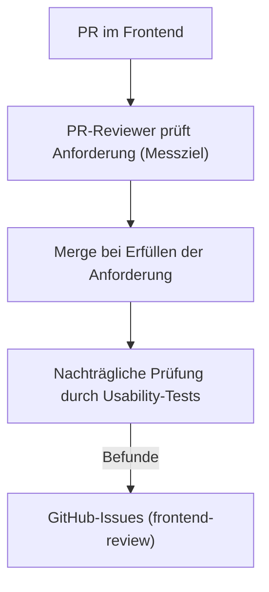
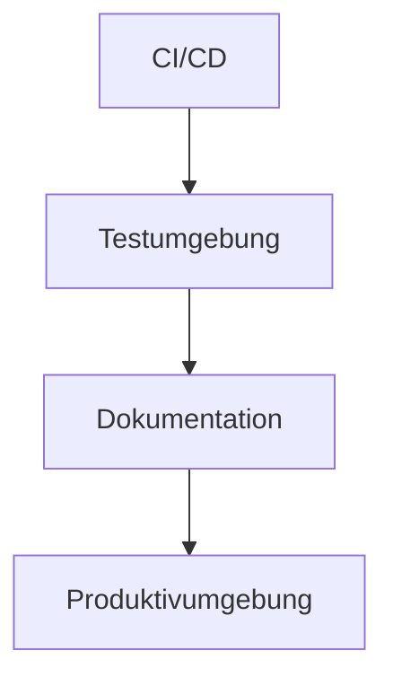

# QS-Ziele & Maßnahmen — ScholarStack

> **Team:** ScholarStack
> **Code-Organisation:** [`github.com/NextAppStore`](https://github.com/NextAppStore)
> **Stand:** 29.10.2026
> **Zweck:** Dokumentation der Qualitätsziele des Projekts und der Maßnahmen, mit denen ScholarStack sie absichert.

> **Hinweis zur Herkunft:** Das Projekt (OpenStack-AppStore) wurde vom Vorgänger-Team (`six7-click-n-deploy`) übernommen. Die CI/CD-Infrastruktur wird von ScholarStack weiterbetrieben; die hier beschriebenen QS-Ziele, -Maßnahmen und -Belege sind der eigene Stand von ScholarStack.
>
> **Beteiligte:** Wanisa Nassery, Jannis Voß, Erik Breuer, Till Burdorf, Jessica Limmer, Michelle, Fabian, Adrian, Sebastian Rudolph _(bitte im Team auf Vollständigkeit prüfen)_

---

## Überblick

Die Qualitätssicherung ist in **drei Bereiche** gegliedert, die jeweils ein Qualitätsziel mit einem **messbaren Kriterium** und konkreten Maßnahmen verbinden:

| Bereich | Qualitätsziel (Kurzform) | Messbares Kriterium |
|---|---|---|
| **1. Usability** | Dozenten stellen VMs ohne tiefe technische Kenntnisse bereit | Kein domänenfremder Begriff auf dem „Golden Path" des Deployments |
| **2. Reliability & Performance** | AppStore und VMs laufen zuverlässig | Keine Downtimes während Vorlesungen |
| **3. Dokumentation** | Übersichtliche Doku für alle Zielgruppen | Einarbeitungsaufwand minimiert |

---

## 1. Usability

### Ziel
- Ein Dozent soll VMs **ohne tiefe technische Kenntnisse** bereitstellen können.
- **Messziel:** Kein Begriff, der nicht zur Domäne „Universität" gehört, soll auf dem **Golden Path** beim Deployment vorkommen.

### Maßnahmen
- **UI-Reviews:** Jeder Pull Request für das Frontend wird gegen dieses Messziel geprüft.
- **Usability-Tests:** mindestens **monatlich** ein Test mit **mind. 2 Personen**, die **nicht** am Frontend beteiligt sind; das Feedback fließt als **GitHub-Issue** zurück.
  - Organisator: Kontaktperson Frontend (**Wanisa Nassery**).

### Ablauf

### Dokumentation der Tests

Die ausgefüllten Protokolle liegen versioniert unter [`docs/frontend-test-reviews`](./frontend-test-reviews). Gefundene Auffälligkeiten werden als **GitHub-Issues** (Label `frontend-review`) erfasst und so einem Fix zugeordnet. Konkrete Ergebnisse stehen bewusst nicht hier, sondern in den Protokollen und Issues.

---

## 2. Reliability & Performance

### Ziel
- Die AppStore-Anwendung läuft **zuverlässig**.
- Virtuelle Maschinen **starten zuverlässig** und funktionieren im Betrieb **reibungslos**.
- **Messbar:** keine Downtimes während Vorlesungen.

### Maßnahmen

1. **CI/CD + Code-Reviews:** keine Codeänderung ohne Tests. Jedes Code-Repo besitzt eine Pipeline (`.github/workflows/ci.yml`), die bei jedem PR und Push läuft; ein PR ist erst mergefähig, wenn Tests/Lint/Typprüfung grün sind **und** ein Review-Approval vorliegt.

   Die CI-Gates gliedern sich in drei Aspekte (verifiziert in den Workflows der Code-Repos, Security teils auch im `deployment`-Repo):

   | Aspekt | Inhalt | Werkzeuge (Repo) |
   |---|---|---|
   | **Automatisierte Tests** | Unit- + Integrationstests, Coverage-Reporting | pytest (backend, worker), Vitest (frontend) |
   | **Statische Analyse** | Linting, Type-Checking, Formatierung | Ruff + MyPy (backend, worker), vue-tsc (frontend) |
   | **Security** | Dependency-Audit, Container-Scan, Secret-Scan, IaC-Scan | npm-/pip-audit, Trivy fs/image/config, Gitleaks |

2. **Testumgebung:** kontrolliertes Starten und Nutzen mehrerer VMs, ggf. mit anderen Gruppen abgestimmt.
3. **Dokumentation:** konkrete Angaben über **Ressourcenverbrauch** und Probleme bei vorhandenen VMs → siehe **§2.1 (VM-Belastbarkeitstest)**.
4. **Produktivumgebung** für den AppStore: Load Balancer, mehrere Instanzen.

### 2.1 Beleg: VM-Belastbarkeitstest (Ressourcenverbrauch)

Als konkrete Angabe zum Ressourcenverbrauch wurde eine bereitgestellte Standard-VM quantitativ vermessen (Benchmarks: `sysbench`, `fio`, `dd`; Baseline via `lscpu`/`free`/`df`).

**Referenz-VM (KVM):**

| Dimension | Messwert | Bewertung |
|---|---|---|
| CPU | 1 vCPU (AMD EPYC-Genoa), **1.742 Events/s** | Engpass — keine Nebenläufigkeit |
| RAM | 1,9 GiB gesamt / 1,6 GiB frei, **0 B Swap**; ~27,8 GiB/s Bandbreite | Kritisch — harter OOM ohne Swap-Puffer |
| Disk (4k random) | **52.300 Read-IOPS / 22.400 Write-IOPS** | Überdimensioniert (NVMe-Klasse) |
| Disk (sequentiell) | **2,4 GB/s** | Überdimensioniert |
| Disk-Kapazität | 6,3 GB frei von 8,7 GB | Knapp |

**Fazit:** limitierend sind CPU (1 Kern) und RAM (2 GB **ohne Swap**, OOM-Risiko); die Platte ist überdimensioniert. Geeignet für einzelne, leichte Dienste.

**Empfehlung an die VM-Ersteller:** (1) Swap (1–2 GB) gegen harte OOM-Abbrüche; (2) bei Nebenläufigkeitsbedarf eine zweite vCPU; (3) Disk-Ressourcen ggf. zugunsten von RAM/CPU umschichten.

### 2.2 Deploymentprozess (Kontext)

Zuverlässigkeit hängt am automatisierten Deployment-Ablauf:

- **Merge in `main`:** GitHub-Workflow im `deployment`-Repo startet.
- VM wird neu erstellt, Docker-Container werden gestartet.
- **AAAA-Record** wird aktualisiert.
- Moodle läuft über einen **separaten Workflow in separater VM**.
- **Manueller Schritt:** Nutzer in Keycloak anlegen.

---

## 3. Dokumentation

### Ziel
- Übersichtliche Dokumentation und Erklärung für **alle Zielgruppen**: IT-Dozenten, BWL-Dozenten, Entwickler, Template-Entwickler, KI-Agenten.
- **Einarbeitungsaufwand minimieren.**

### Maßnahmen

| # | Maßnahme | Verantwortlich |
|---|---|---|
| 1 | Agent-Harness hinzufügen und laufend aktuell halten | Till (+ Sub-Gruppen) |
| 2 | User Stories dokumentieren und explizit in den Dokus beachten | Jessica & Michelle |
| 3 | Separate Dokumentationen je Zielgruppe | Team |
| 4 | Skill für interaktive App-Template-Erstellung | Fabian & Erik |

---

## 4. Zusammenfassung

ScholarStack sichert die Qualität über drei Bereiche mit jeweils messbarem Ziel:

- **Usability:** PR-UI-Reviews gegen ein Messziel + monatliche, rollenbasierte Usability-Tests; Befunde werden als GitHub-Issues (`frontend-review`) nachverfolgt.
- **Reliability & Performance:** CI/CD + verpflichtende Code-Reviews (kein Code ohne Tests), kontrollierte Testumgebung, dokumentierter VM-Ressourcenverbrauch (§2.1), geplante Produktivumgebung mit Load Balancer.
- **Dokumentation:** zielgruppengerechte Doku, Agent-Harness, User-Story-Pflege, App-Template-Skill.

Belege: Workflow-Dateien (`.github/workflows/`), PR-/Actions-Tabs der Repos, Usability-Protokolle unter `docs/frontend-test-reviews` sowie der VM-Belastbarkeitstest (§2.1).

